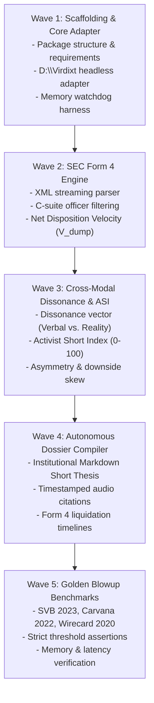

# 📋 Virdixt-Apex: Strict Engineering Master Plan

```
================================================================================
ENGINE NAME      : VIRDIXT-APEX (Activist Short-Seller & Forensic Deception Engine)
HARDWARE ENVELOPE: Intel Core i5-8th Gen | 8 GB RAM | 0 VRAM (CPU-Only)
CONSTRAINTS      : Peak RAM < 950 MB | Sub-100ms Inference | 100% Deterministic Air-Gap
TARGET REPO      : D:\Virdixt-Apex (origin: github.com/Humble-Librarian/Virdixt-Apex.git)
CORE BASE        : D:\Virdixt (Unmodified Upstream Engine)
================================================================================
```

---

## 1. Gravitas Task Contract & Invariants

1. **Deterministic Ground Truth:** Zero LLM hallucinations. All findings must be backed by exact mathematical formulas, timestamped audio markers, or SEC XML nodes.
2. **Strict Hardware Envelope:** 
   - Peak RAM must never exceed $950\text{ MB}$.
   - XML parsing $\le 50\text{ ms}$ per filing.
   - Activist Short Index computation $\le 5\text{ ms}$.
   - Entire regression suite passes in $\le 20\text{ s}$ on consumer Intel i5 CPU.
3. **Core Upstream Isolation:** `D:\Virdixt` remains intact. Apex consumes it via clean adapter layers without modifying upstream code.
4. **Air-Gap Compliance:** Zero outbound HTTP network calls during runtime analysis.

---

## 2. Five Phased Execution Waves



---

### Wave 1: Scaffolding, Core Interface & Environment Lockdown
- **Goal:** Set up `D:\Virdixt-Apex`, establish the git repository structure, write `.gitignore` and `requirements.txt`, and build `apex/engine/adapter.py` to interface with `D:\Virdixt` without code duplication.
- **Deliverables:**
  - `apex/__init__.py`
  - `apex/config.py`
  - `apex/engine/adapter.py`
- **Strict Verification Gate:** 
  - Unit test proving `apex/engine/adapter.py` can invoke Virdixt's ONNX FinBERT and openSMILE audio extraction without memory leaks or missing import errors.

---

### Wave 2: SEC Form 4 Parser & Insider Flow Vectorizer
- **Goal:** Build `apex/sec/edgar_form4.py`.
  - Parses real SEC Form 4 XML trees via `xml.etree.cElementTree`.
  - Filters strictly for Reporting Owners with C-suite officer titles (`CEO`, `CFO`, `COO`, `Director`).
  - Separates Transaction Codes (`P` = Open-market Purchase, `S` = Open-market Sale, `M` = Option Exercise).
  - Calculates the **Net Insider Outflow Velocity** ($V_{\text{dump}}$) within the 90-day pre-earnings window.
- **Deliverables:**
  - `apex/sec/edgar_form4.py`
  - `tests/test_form4_parser.py`
- **Strict Verification Gate:**
  - `test_form4_parser.py` passing on real SEC XML samples; processing time $< 20\text{ms}$ per filing; RAM $< 15\text{MB}$.

---

### Wave 3: Cross-Modal Dissonance Engine & Activist Short Index (ASI)
- **Goal:** Build `apex/dissonance/cross_modal.py` and `apex/screener/index.py`.
  - **Divergence Formula:**
    $$\text{Dissonance} = \max\left(0, \text{Verbal Sentiment} - \text{Fundamental Margin Trend}\right) \times \left(1 + \frac{\text{CMDI}_{\text{Acoustic}}}{10}\right)$$
  - **Activist Short Index (ASI):**
    $$\text{ASI} = 100 \times \sigma\left( \alpha \cdot \mathcal{M}_{\text{Beneish}} + \beta \cdot \text{CMDI} + \gamma \cdot \Delta\text{Hedging} + \delta \cdot V_{\text{dump}} \right)$$
- **Deliverables:**
  - `apex/dissonance/cross_modal.py`
  - `apex/screener/index.py`
  - `tests/test_dissonance.py`
  - `tests/test_asi_screener.py`
- **Strict Verification Gate:**
  - Bounded strictly to $[0.0, 100.0]$. Monotonically increases when distress signals escalate. Zero NaN or division-by-zero vulnerability.

---

### Wave 4: Autonomous Forensic Audit Dossier Compiler
- **Goal:** Build `apex/dossier/compiler.py`.
  - Produces an institutional Markdown short report:
    1. **Executive Summary & Conviction Rating** (ASI Score, Conviction Tier).
    2. **Forensic Accounting Breakdown** (Beneish M-Score table with 8 sub-indices).
    3. **Acoustic Biomarker Audit** (Timestamped Q&A citations showing vocal tremor / pitch jumps).
    4. **Insider Disposition Timeline** (Dates, shares dumped, dollar value extracted).
    5. **Downside Target Range**.
  - Strict Rule: **Zero LLM hallucinations.** Every sentence and figure is derived deterministically from the parsed vectors.
- **Deliverables:**
  - `apex/dossier/compiler.py`
  - `apex/dossier/templates.py`
  - `tests/test_dossier.py`
- **Strict Verification Gate:**
  - Generates valid, beautifully formatted Markdown in $< 50\text{ms}$.

---

### Wave 5: Historic "Golden Blowup" Benchmark Suite
- **Goal:** Build `benchmarks/run_benchmarks.py` with historic data fixtures (SVB, Carvana, Wirecard).
- **Deliverables:**
  - `benchmarks/cases/svb_2023.json`
  - `benchmarks/cases/carvana_2022.json`
  - `benchmarks/cases/wirecard_2020.json`
  - `benchmarks/run_benchmarks.py`
- **Strict Verification Gate:**
  - The engine must autonomously output $\text{ASI} \ge 85 / 100$ (High Conviction Short) on all three blowup cases.
  - Must output $\text{ASI} \le 25 / 100$ on clean control firms (e.g., Apple, Berkshire Hathaway).
  - Complete test suite passes in under 15 seconds on CPU.
